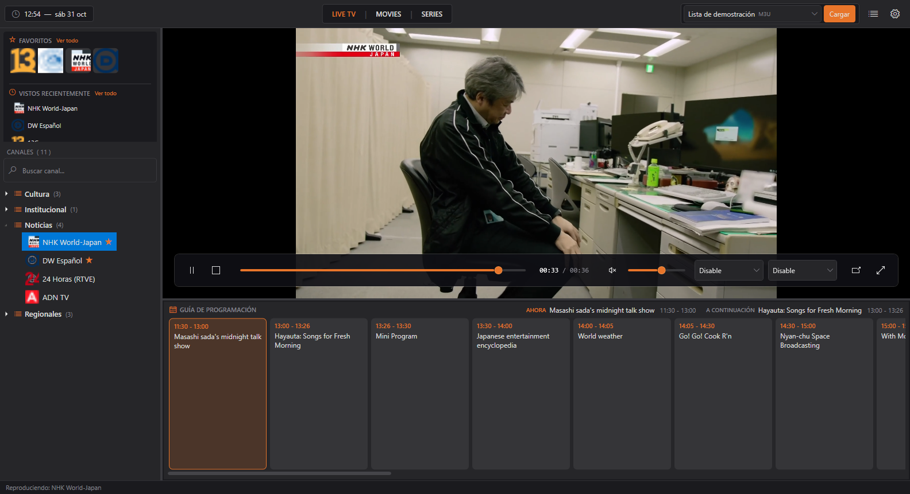
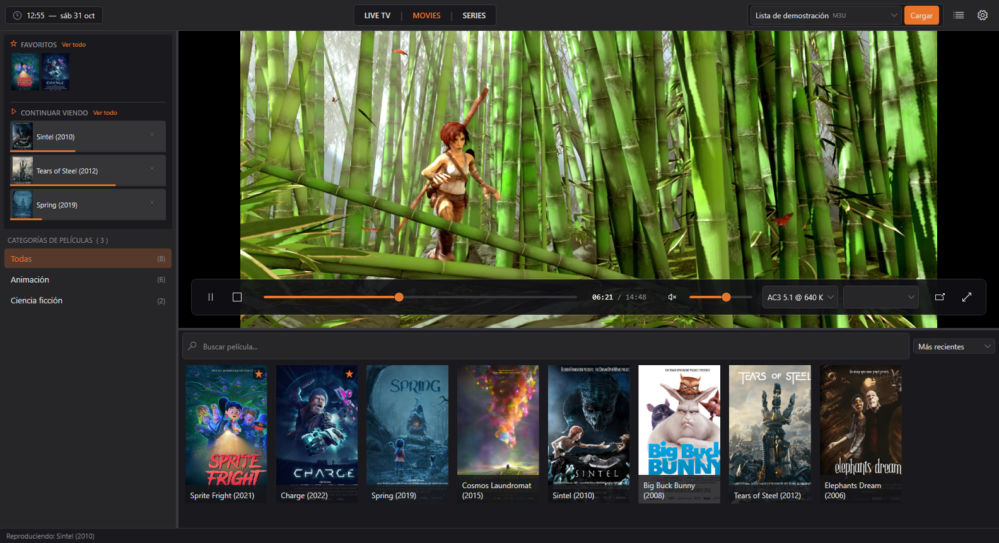
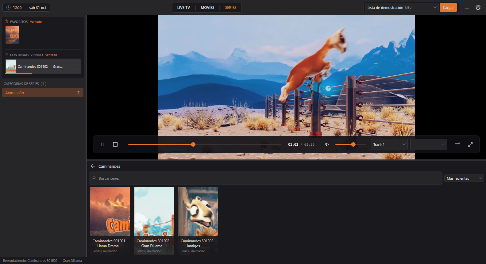
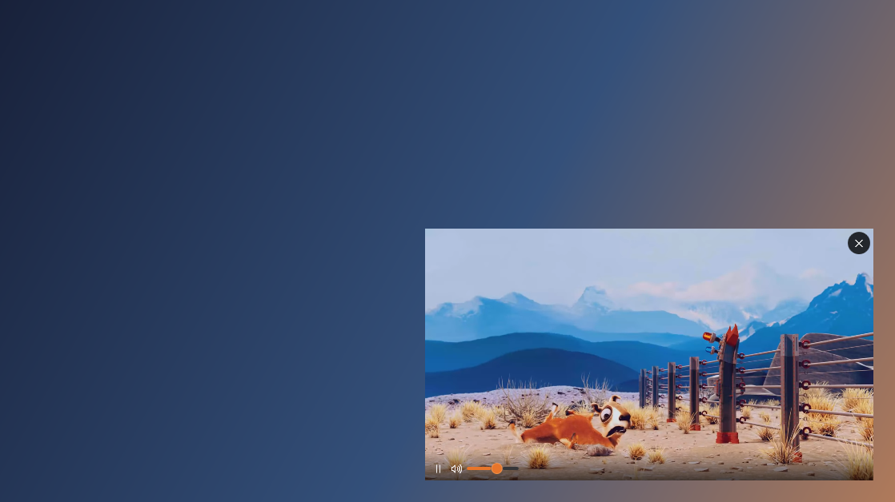

<p align="center">
  
</p>

<h1 align="center">Chucao</h1>

<p align="center">
  Reproductor IPTV para Windows: abre tus listas M3U o tu cuenta Xtream Codes, con guía de programación,<br>
  series por temporadas, «Continuar viendo» y Picture-in-Picture.
</p>

<p align="center">
  <a href="https://github.com/john-Mcan/iptv-player/actions/workflows/ci.yml"></a>
  
  <a href="LICENSE.md"></a>
  <a href="https://github.com/john-Mcan/iptv-player/releases/latest"></a>
</p>

<p align="center">
  <a href="https://github.com/john-Mcan/iptv-player/releases/latest"><b>Descargar la última versión</b></a>
  · Windows 10 y 11 de 64 bits · no necesita instalar .NET
</p>



> [!IMPORTANT]
> Chucao es solo un reproductor: **no incluye canales, listas ni contenido de ningún tipo**. Cada persona usa sus propias listas o cuentas y es responsable de tener derecho a ver lo que reproduce.

## Funciones

### Fuentes

- Listas **M3U/M3U8** desde una URL o un archivo local, con `tvg-id`, `tvg-name`, `tvg-logo` y `group-title`.
- Cuentas **Xtream Codes** (servidor, usuario y contraseña). La contraseña se guarda cifrada para tu usuario de Windows.
- Varias fuentes guardadas con nombre propio. La última se carga sola al abrir la app (se puede desactivar).
- Clasificación automática en TV en vivo, Películas y Series.

### TV en vivo y guía de programación

- Canales agrupados, búsqueda, favoritos y «Vistos recientemente».
- **EPG** en formato XMLTV, también comprimida con GZip. La URL sale de `url-tvg` o `x-tvg-url` en la lista, o del panel Xtream, y se vincula por `tvg-id` o `tvg-name`.
- **Programa actual y siguiente** en la cabecera de la guía y en pantalla completa; se actualiza cada minuto.

### Películas y series

- Grilla de pósters con búsqueda y orden (más recientes, A-Z, Z-A).
- **«Continuar viendo»** con barra de progreso: retoma donde quedaste.
- **Series por temporadas y episodios**, a partir de nombres como `S01E01`, `T01E01` o `1x01`.
- **Siguiente episodio automático** al terminar un capítulo (conserva el audio, los subtítulos y la pantalla completa) y botón **«Siguiente capítulo»** cerca del final.

### Reproducción

- Motor LibVLC: HLS, DASH, RTMP, RTSP y contenido bajo demanda; cambio de pistas de audio y subtítulos.
- **Reconexión automática** si el stream se corta, con espera creciente (1 s, 2 s, 4 s… hasta 30 s) y un máximo de intentos configurable.
- **Pantalla completa** con controles que se ocultan solos.
- **Picture-in-Picture**: ventana flotante siempre visible, que se puede arrastrar y redimensionar, con volumen en la rueda del mouse. Al cerrarla vuelves al mismo punto.

### Configuración

- Carga automática de la última fuente, intentos de reconexión, filtro de contenido para adultos, y limpieza del historial y los favoritos.
- Recuerda el volumen, la pestaña, el ancho del panel y el tamaño y la posición de la ventana, también con varios monitores.

## Capturas

| Películas | Series | Picture-in-Picture |
|---|---|---|
|  |  |  |

## Uso

1. Abre `IPTVPlayer.exe`.
2. Haz clic en el ícono de **Fuentes** (junto a la configuración) y agrega una lista M3U (URL o archivo) o una cuenta Xtream.
3. Pulsa **Guardar y cargar**. Los canales aparecen en TV en vivo, Películas y Series.
4. Para cambiar de fuente, elígela en el selector del encabezado y pulsa **Cargar**.

### Atajos de teclado

| Tecla | Acción |
|---|---|
| F11 | Entrar o salir de pantalla completa |
| Esc | Salir de pantalla completa |
| Espacio | Reproducir o pausar |
| Doble clic en el video | Salir de pantalla completa |

## Requisitos

- **Para usarla:** Windows 10 u 11 de 64 bits. El zip del release es autocontenido: trae el runtime de .NET y LibVLC.
- **Para compilarla:** [.NET 10 SDK](https://dotnet.microsoft.com/download/dotnet/10.0).

## Compilar, probar y publicar

```bash
dotnet run --project src/IPTVPlayer                    # ejecutar en modo desarrollo
dotnet test --solution IPTVPlayer.slnx                 # correr los tests
dotnet publish src/IPTVPlayer -c Release -r win-x64 --self-contained -o publish
```

`publish/` queda con un ejecutable autocontenido. Cada push corre la compilación y los tests en GitHub Actions, y cada tag `v*` publica un release con el zip ([cómo publicar una versión](docs/release.md)).

## Estructura del proyecto

```
IPTVPlayer.slnx
src/
  IPTVPlayer.Core/              Lógica sin interfaz (net10.0)
    Models/                     Channel, ContentCategory, PlaylistSource, EpgProgram,
                                WatchHistoryEntry, AppSettings…
    Services/
      M3UParserService.cs       Parser de listas M3U/M3U8
      PlaylistService.cs        Carga de listas y clasificación en TV en vivo, películas y series
      XtreamApiService.cs       Cliente de la API de Xtream Codes
      EpgService.cs             Guía XMLTV, plana o .gz
      EpisodeParser.cs          Detección de S01E01, T01E01 y 1x01
      SeriesCatalog.cs          Series, temporadas, episodios y siguiente episodio
      WatchHistory.cs           «Vistos recientemente» y «Continuar viendo»
      Favorites.cs              Favoritos por URL y por serie
      SettingsService.cs        Configuración en %APPDATA%\IPTVPlayer\settings.json
      SecretProtector.cs        Cifrado de contraseñas con DPAPI
  IPTVPlayer/                   App WPF (net10.0-windows)
    App.xaml                    Fusiona los estilos de Themes/
    MainWindow.xaml             Encabezado, reproductor, pantalla completa y PiP
    Themes/                     Colors, Icon, Buttons, Inputs, Lists, ScrollBars
    ViewModels/                 MainViewModel, PlayerViewModel, EpgViewModel
    Views/                      LiveTvSidebar, EpgPanel, MoviesSidebar, MoviesPanel,
                                SeriesSidebar, SeriesPanel, FullListView,
                                SourcesWindow, SettingsWindow, PiPWindow
    Converters/
    Assets/                     chucao.svg y chucao.ico
tests/
  IPTVPlayer.Tests/             xUnit v3: listas, EPG, series, historial, favoritos,
                                fuentes, Xtream y configuración
tools/
  New-AppIcon.ps1               Regenera el .ico desde el ícono vectorial
docs/                           Arquitectura, próximos pasos, publicación y capturas
.github/                        CI, release y Dependabot
```

## Stack

| Componente | Tecnología |
|---|---|
| Plataforma | .NET 10 (LTS) |
| Interfaz | WPF |
| Video | LibVLC 3 con LibVLCSharp |
| MVVM | CommunityToolkit.Mvvm |
| Grillas virtualizadas | VirtualizingWrapPanel |
| Persistencia | System.Text.Json en `%APPDATA%`; contraseñas con DPAPI |
| Tests | xUnit v3 sobre Microsoft Testing Platform |
| CI/CD | GitHub Actions y Dependabot |

## Decisiones técnicas

- **Controles sobre el video.** WPF no puede dibujar sobre el HWND de LibVLC (airspace), así que todos los controles superpuestos van dentro de `VideoView.Content`.
- **PiP con su propia instancia de LibVLC.** En LibVLC 3 un reproductor no se puede mover a otra ventana. El PiP abre su propia conexión y, al cerrarlo, la ventana principal retoma la posición (VOD) o se reconecta (en vivo).
- **Nada de llamadas a LibVLC desde sus eventos.** Los handlers solo despachan al hilo de la UI y lo que bloquea corre en `Task.Run`, para evitar deadlocks.
- **Reconexión con espera exponencial**, cancelable, que retoma la posición en contenido bajo demanda.
- **Todavía LibVLC 3.** LibVLC 4 resolvería el airspace, pero cuando se evaluó (febrero de 2026) no tenía versión estable.
- **Episodios de Xtream bajo demanda,** nombrados igual que en una M3U, para reutilizar la misma navegación de series.

El detalle está en [docs/arquitectura.md](docs/arquitectura.md).

## Próximos pasos

- Sacar los controles del reproductor de `MainWindow` y seguir achicando `MainViewModel`.
- No guardar las credenciales de Xtream dentro de las URLs del historial y los favoritos.
- Metadatos de películas y series (sinopsis, año) y Stalker Portal.
- Ordenar canales, grabar el stream, menú contextual e instalador MSIX.

La lista completa está en [docs/roadmap.md](docs/roadmap.md) y el historial de versiones, en el [CHANGELOG](CHANGELOG.md).

## Contribuciones

Los aportes son bienvenidos. Puedes abrir un *issue* para reportar errores o proponer mejoras, o enviar un *pull request* desde un fork del repositorio.

Al enviar un aporte, aceptas que se publique bajo la misma licencia del proyecto ([PolyForm Noncommercial 1.0.0](LICENSE.md)).

## Licencia

Copyright (c) 2026 John Moya C.

Este proyecto es de **código fuente disponible** (no es *open source* en el sentido OSI) y se distribuye bajo la licencia [PolyForm Noncommercial 1.0.0](LICENSE.md).

**Permitido:**

- Ver, estudiar y compilar el código.
- Usarlo con fines personales y no comerciales (estudio, entretenimiento privado, proyectos de hobby, investigación).
- Hacer forks y modificaciones para proponer mejoras al proyecto.
- Uso por organizaciones sin fines de lucro, instituciones educativas y entidades públicas.

**No permitido:**

- Cualquier uso comercial: vender el software o versiones derivadas, incluirlo en productos o servicios pagados, o usarlo dentro de una empresa con fines de lucro.

Al redistribuir el código (por ejemplo, en un fork), debes incluir el archivo [LICENSE.md](LICENSE.md) con su línea `Required Notice`. El texto de [LICENSE.md](LICENSE.md) es el que rige; este resumen es solo orientativo.

Para consultas sobre uso comercial, contacta al autor.

### Dependencias de terceros

Las dependencias mantienen sus propias licencias: LibVLC y LibVLCSharp (LGPL-2.1-or-later), CommunityToolkit.Mvvm (MIT), VirtualizingWrapPanel (MIT) y System.Security.Cryptography.ProtectedData (MIT).
